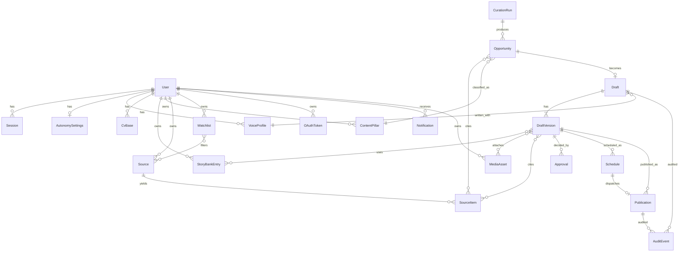
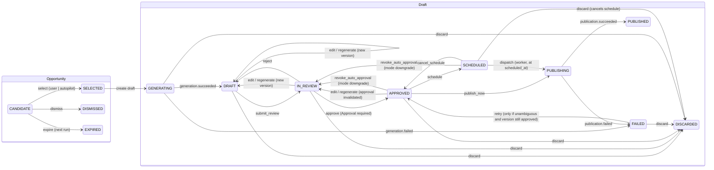

# Data model

- Owner: Atlas (Principal Architect); implementação e migrations: Alicerce (backend)
- Status: rascunho da Onda 1 (2026-10-13)
- Relacionados: `system-overview.md`, `contracts.md`, ADR-0003 (idempotent publishing), ADR-0004 (token encryption), ADR-0007 (auth)

Convenções:

- Tabelas e colunas em inglês, `snake_case` no PostgreSQL, `camelCase` no Prisma/TS.
- Chaves primárias `uuid` (v7, ordenável no tempo), geradas na aplicação.
- Todo timestamp é `timestamptz` (UTC). Horário local só existe junto de um `timezone` IANA explícito.
- Toda raiz de agregado tem `user_id` (dono). Hoje há um único usuário; a autorização é centralizada
  (ver ADR-0007) para permitir multiusuário sem reescrever o schema.
- `created_at`/`updated_at` em todas as tabelas; `deleted_at` só onde soft delete fizer sentido
  (Source, StoryBankEntry, ContentPillar). Entidades do pipeline editorial **não** são apagadas: são
  `dismissed`/`discarded` e ficam para auditoria.
- Colunas `jsonb` têm schema Zod em `packages/contracts` e são validadas na escrita.

---

## 1. Visão geral (ER)

Relações N:N são tabelas de junção explícitas: `opportunity_source_items`, `draft_version_source_items`,
`draft_version_story_entries`, `draft_version_media_assets`, `watchlist_sources`.

---

## 2. Entidades

Campos essenciais; Alicerce pode acrescentar colunas técnicas sem ADR. Mudar relação, enum ou invariante exige revisão de Atlas.

### 2.1 Identidade e acesso

**User**

| Campo                   | Tipo                                    | Notas                                                                                                          |
| ----------------------- | --------------------------------------- | -------------------------------------------------------------------------------------------------------------- |
| id                      | uuid PK                                 |                                                                                                                |
| email                   | citext unique                           | login                                                                                                          |
| password_hash           | text                                    | Argon2id (ADR-0007)                                                                                            |
| name                    | text                                    |                                                                                                                |
| role                    | enum `UserRole` {OWNER, EDITOR, VIEWER} | hoje só OWNER existe; enum já previsto                                                                         |
| locale                  | text                                    | `pt-BR` padrão                                                                                                 |
| timezone                | text                                    | IANA, `America/Sao_Paulo` padrão; usado para exibir e para propor horários                                     |
| linkedin_member_urn     | text null                               | `urn:li:person:...`, preenchido ao conectar OAuth                                                              |
| totp_secret_ciphertext  | bytea null                              | reservado para TOTP (ADR-0007 §4); cifrado com o envelope do ADR-0004 quando a feature existir; nunca em claro |
| created_at / updated_at | timestamptz                             |                                                                                                                |

**Session** — `id` uuid (identificador público, usado em `GET /auth/sessions`), `secret_hash` (SHA-256 do segredo opaco de
256 bits que vai no cookie; o segredo nunca é persistido), `user_id`, `expires_at`, `last_seen_at`, `elevated_until`
(fim da janela elevada de 15 min aberta por `POST /auth/reauth`, ADR-0007; null = não elevada), `ip`, `user_agent`,
`revoked_at`.

**OAuthToken** (cifrado em repouso, ADR-0004)

| Campo                            | Tipo                                                           | Notas                                                                             |
| -------------------------------- | -------------------------------------------------------------- | --------------------------------------------------------------------------------- |
| id                               | uuid PK                                                        |                                                                                   |
| user_id                          | FK User                                                        | unique (user_id, provider)                                                        |
| provider                         | enum `OAuthProvider` {LINKEDIN}                                |                                                                                   |
| provider_subject                 | text                                                           | `sub`/member URN do provedor                                                      |
| access_token_ciphertext          | bytea                                                          | AES-256-GCM, nonce + tag embutidos                                                |
| refresh_token_ciphertext         | bytea null                                                     | LinkedIn só emite refresh token para alguns produtos; pode ser nulo               |
| wrapped_dek                      | bytea                                                          | DEK da credencial cifrada pela KEK ativa, mesmo framing autenticado (ADR-0004 §1) |
| key_version                      | text                                                           | versão da KEK que embrulhou a DEK (rotação, ADR-0004 §8)                          |
| scopes                           | text[]                                                         | ex.: `openid profile w_member_social`                                             |
| access_expires_at                | timestamptz                                                    |                                                                                   |
| refresh_expires_at               | timestamptz null                                               |                                                                                   |
| status                           | enum `TokenStatus` {ACTIVE, EXPIRED, REVOKED, REAUTH_REQUIRED} |                                                                                   |
| last_refreshed_at / last_used_at | timestamptz null                                               |                                                                                   |

Invariantes: a API **nunca** serializa colunas `*_ciphertext`; só o worker e o fluxo de callback decifram;
`status = REAUTH_REQUIRED` bloqueia `publication.publish` e gera `Notification`.

**AutonomySettings** (1:1 com User)

| Campo                   | Tipo                                                                 | Notas                                                                                                                                                        |
| ----------------------- | -------------------------------------------------------------------- | ------------------------------------------------------------------------------------------------------------------------------------------------------------ |
| user_id                 | FK User PK                                                           |                                                                                                                                                              |
| mode                    | enum `AutonomyMode` {ASSISTED, AUTOPILOT_CONTROLLED, AUTOPILOT_FULL} | padrão ASSISTED                                                                                                                                              |
| auto_approve_min_score  | numeric(5,2) null                                                    | só nos modos autopilot                                                                                                                                       |
| allowed_pillar_ids      | uuid[]                                                               | pilares em que o autopilot pode agir; vazio = nenhum                                                                                                         |
| max_auto_posts_per_week | int                                                                  | guarda-corpo                                                                                                                                                 |
| cancel_window_minutes   | int                                                                  | CONTROLLED: janela entre notificar e publicar (padrão 60)                                                                                                    |
| assisted_prefetch_draft | bool                                                                 | padrão false; só tem efeito em ASSISTED: pré-gera rascunho da **melhor** candidata elegível (uma, nunca cinco) e propõe slot, sem aprovar nada (PRD v0.2 §6) |
| media_requires_human    | bool                                                                 | padrão true; vale em **todos** os modos                                                                                                                      |
| quiet_hours             | jsonb null                                                           | `{ start: "22:00", end: "07:00", timezone }`                                                                                                                 |
| updated_at              | timestamptz                                                          | toda mudança gera `AuditEvent`                                                                                                                               |

Semântica dos modos (decisão provisória do Maestro em 2026-10-13; Farol alinha o PRD; Rodrigo ratifica — Q6):

- **ASSISTED** (padrão): sistema vai até `DRAFT`; aprovação, agendamento e publicação são humanos.
  Com `assisted_prefetch_draft = true`, o run também gera um `Draft{is_prefetch=true}` para a candidata de
  maior score elegível e grava `proposed_slot`; a oportunidade continua `CANDIDATE`. Selecionar essa
  candidata **adota** o rascunho (`is_prefetch=false`, oportunidade `SELECTED`); selecionar outra descarta o
  prefetch (`DISCARDED`, `discard_reason = PREFETCH_SUPERSEDED`). Respeita o briefing §1.2: nunca cinco posts.
- **AUTOPILOT_CONTROLLED**: sistema pode `SELECT` a melhor oportunidade elegível, gerar, auto-aprovar
  (`Approval.actor = SYSTEM`, com `reason`) e agendar; **notifica via Telegram** e espera
  `cancel_window_minutes` (padrão 60) antes de `PUBLISHING`. Rodrigo pode cancelar na janela.
- **AUTOPILOT_FULL**: igual ao anterior, sem janela de cancelamento; notifica depois.

Em **qualquer** modo, mídia só é publicada com aprovação humana enquanto `media_requires_human = true`
(padrão). **Descer de modo** (`FULL → CONTROLLED → ASSISTED`) revoga toda aprovação automática ainda não
publicada: drafts `APPROVED`/`SCHEDULED` cuja `approved_version_id` tem `Approval.actor = SYSTEM` voltam a
`IN_REVIEW`, o `Schedule` é cancelado e Rodrigo recebe **uma** `Notification{kind = AUTOPILOT_REVOKED}` com a
lista; aprovações humanas não mudam (PRD v0.2 §6). `AUTOPILOT_FULL` só pode ser selecionado se a flag operacional `AUTOPILOT_FULL_ENABLED` estiver
ligada (padrão desligada até fechar os gates G-01..G-06 de `docs/security/threat-model.md`); elevar o modo
exige sessão elevada e gera `AuditEvent` (TM-22). O worker revalida o modo vigente no momento do publish.

### 2.2 Memória editorial

**VoiceProfile** — `id`, `user_id`, `version` int, `is_active` bool (unique parcial `(user_id) where is_active`),
`language` (`pt-BR`|`en`), `tone` text, `principles` text[] (o que fazer), `avoid` text[] (o que evitar),
`banned_phrases` text[], `vocabulary` jsonb, `examples` jsonb (trechos reais aprovados por Rodrigo),
`notes` text. Alterar = nova versão (imutável depois de usada por um `DraftVersion`).

**StoryBankEntry** — `id`, `user_id`, `title`, `narrative` text (primeira pessoa, **fornecida por Rodrigo**),
`context`, `lesson`, `facts` jsonb (`[{ claim, value, source_url|null, verified_at }]`),
`tags` text[], `pillar_ids` uuid[], `usage_count` int, `last_used_at`, `status` {ACTIVE, ARCHIVED},
`deleted_at`. Invariante: o sistema **nunca cria** entradas; só Rodrigo (ou importação explícita por ele).

**ContentPillar** — `id`, `user_id`, `slug` unique por user, `name`, `description`, `target_audience`,
`weight` numeric (prioridade no ranking), `is_active`, `deleted_at`.

### 2.3 Fontes e coleta (dados não confiáveis)

**Source**

| Campo                        | Tipo                                    | Notas                                                    |
| ---------------------------- | --------------------------------------- | -------------------------------------------------------- |
| id, user_id                  |                                         |                                                          |
| type                         | enum `SourceType` {RSS, ATOM, URL_LIST} | sem LinkedIn scraping por desenho                        |
| name, url                    | text                                    | `url` validada: https, host em allowlist, sem IP privado |
| trust_level                  | enum {LOW, MEDIUM, HIGH}                | pesa no ranking e na exigência de fonte adicional        |
| pillar_hints                 | uuid[]                                  |                                                          |
| fetch_interval_minutes       | int                                     | mínimo 60                                                |
| is_active                    | bool                                    |                                                          |
| etag, last_modified          | text null                               | cache condicional                                        |
| last_fetched_at, last_status |                                         | `last_status` {OK, FAILED, BLOCKED} + `last_error`       |
| deleted_at                   |                                         |                                                          |

**Watchlist** — `id`, `user_id`, `name`, `keywords` text[], `pillar_id` null, `is_active`; junção
`watchlist_sources` (opcional; vazio = todas as fontes ativas). Serve para filtrar/boostar `SourceItem`
por termos; **não** monitora o LinkedIn.

**SourceItem** (conteúdo coletado; **sempre não confiável**)

| Campo         | Tipo             | Notas                                                        |
| ------------- | ---------------- | ------------------------------------------------------------ |
| id            | uuid             |                                                              |
| source_id     | FK               |                                                              |
| external_id   | text             | guid do feed ou hash da URL; unique (source_id, external_id) |
| canonical_url | text             | normalizada (sem utm, sem fragmento)                         |
| title, author | text             | sanitizados (texto puro, tamanho máximo)                     |
| content_text  | text             | HTML → texto, máx. N KB; HTML cru **não** é guardado         |
| content_hash  | text             | sha256 do texto normalizado; índice para dedupe              |
| language      | text null        |                                                              |
| published_at  | timestamptz null | do feed; `fetched_at` é o nosso                              |
| fetched_at    | timestamptz      |                                                              |
| trust         | const UNTRUSTED  | coluna gerada/constante para lembrar o consumidor            |

Nenhum campo de `SourceItem` entra em `instructions` de prompt; só em `input` delimitado (ADR-0005).

### 2.4 Curadoria e oportunidades

**CurationRun**

| Campo                                            | Tipo                                                                   | Notas                                                             |
| ------------------------------------------------ | ---------------------------------------------------------------------- | ----------------------------------------------------------------- |
| id, user_id                                      |                                                                        |                                                                   |
| scheduled_for                                    | timestamptz                                                            | unique (user_id, scheduled_for, trigger) → cron idempotente (I13) |
| timezone                                         | text                                                                   | `America/Sao_Paulo`                                               |
| trigger                                          | enum {CRON, MANUAL}                                                    |                                                                   |
| status                                           | enum `CurationRunStatus` {QUEUED, RUNNING, SUCCEEDED, PARTIAL, FAILED} | PARTIAL = < 5 oportunidades                                       |
| started_at, finished_at                          |                                                                        |                                                                   |
| stats                                            | jsonb                                                                  | `{ sourcesFetched, itemsNew, itemsDeduped, candidatesScored }`    |
| engine_version, prompt_id, prompt_version, model | text                                                                   | reprodutibilidade                                                 |
| error                                            | jsonb null                                                             | classificado, sem segredos                                        |
| job_id                                           | text null                                                              | pg-boss                                                           |

**Opportunity** (contrato do briefing §13 + campos internos)

| Campo                                 | Tipo                                                               | Notas                                                                                                                                                                                     |
| ------------------------------------- | ------------------------------------------------------------------ | ----------------------------------------------------------------------------------------------------------------------------------------------------------------------------------------- |
| id                                    | uuid                                                               |                                                                                                                                                                                           |
| user_id                               | FK                                                                 |                                                                                                                                                                                           |
| curation_run_id                       | FK null                                                            | null quando `origin = MANUAL`                                                                                                                                                             |
| origin                                | enum {CURATION, MANUAL}                                            | entrada manual de assunto entra aqui com status `selected`                                                                                                                                |
| title                                 | text                                                               |                                                                                                                                                                                           |
| summary                               | text                                                               |                                                                                                                                                                                           |
| published_at                          | timestamptz null                                                   | atualidade do conteúdo-fonte                                                                                                                                                              |
| content_pillar_id                     | FK ContentPillar                                                   | §13 `contentPillar` (slug exposto na API)                                                                                                                                                 |
| target_audience                       | text                                                               |                                                                                                                                                                                           |
| relevance_reason                      | text                                                               |                                                                                                                                                                                           |
| suggested_angle                       | text                                                               |                                                                                                                                                                                           |
| suggested_format                      | enum `SuggestedFormat` {TEXT, CODE_CARD, IMAGE, CAROUSEL}          | §13 `text                                                                                                                                                                                 | code-card | image | carousel` |
| score                                 | numeric(5,2)                                                       | 0–100                                                                                                                                                                                     |
| score_breakdown                       | jsonb                                                              | `{ recency, pillarFit, audienceFit, novelty, sourceTrust, voiceFit, risk }` — `voiceFit`/`risk` adicionados em 2026-10-13 (proposta de Pena, `docs/editorial/structured-outputs.md` §1.2) |
| rank                                  | int null                                                           | 1–5 dentro do run                                                                                                                                                                         |
| status                                | enum `OpportunityStatus` {CANDIDATE, SELECTED, DISMISSED, EXPIRED} | §13                                                                                                                                                                                       |
| selected_at, dismissed_at, expires_at | timestamptz null                                                   | `expires_at` = próximo run por padrão                                                                                                                                                     |
| dismiss_reason                        | text null                                                          |                                                                                                                                                                                           |

Junção `opportunity_source_items (opportunity_id, source_item_id)` ↔ §13 `sourceIds`.

Invariantes:

- Um `CurationRun` `SUCCEEDED` tem **exatamente 5** oportunidades `CANDIDATE` com `rank` 1..5 únicos.
- Oportunidade `CANDIDATE` sem decisão até `expires_at` vira `EXPIRED` (job `curation.expire`).
- Só uma oportunidade pode virar `Draft` (`opportunity_id` unique). `SELECTED` ⇔ existe `Draft` com
  `is_prefetch = false`; um `Draft{is_prefetch = true}` pode coexistir com `CANDIDATE` (no máximo um por run).
- `DISMISSED`/`EXPIRED` não são apagadas (alimentam analytics e evitam repetição).

### 2.5 Rascunhos e versões

**Draft** (agregado do ciclo de vida; estados de `GENERATING` em diante)

| Campo                        | Tipo                                                                                                             | Notas                                                                                                |
| ---------------------------- | ---------------------------------------------------------------------------------------------------------------- | ---------------------------------------------------------------------------------------------------- |
| id, user_id                  |                                                                                                                  |                                                                                                      |
| opportunity_id               | FK unique                                                                                                        |                                                                                                      |
| voice_profile_id             | FK                                                                                                               | versão de voz usada                                                                                  |
| status                       | enum `DraftStatus` {GENERATING, DRAFT, IN_REVIEW, APPROVED, SCHEDULED, PUBLISHING, PUBLISHED, FAILED, DISCARDED} | ver §3                                                                                               |
| current_version_id           | FK DraftVersion null                                                                                             | última versão (editada ou gerada)                                                                    |
| approved_version_id          | FK DraftVersion null                                                                                             | versão que pode ser publicada                                                                        |
| language                     | text                                                                                                             | `pt-BR` padrão                                                                                       |
| row_version                  | int                                                                                                              | optimistic locking (`expectedVersion` na API)                                                        |
| failure_reason               | jsonb null                                                                                                       | quando FAILED                                                                                        |
| needs_reconciliation         | bool                                                                                                             | true quando a última `Publication` ficou `AMBIGUOUS` (ADR-0003); bloqueia `retry` até reconciliar    |
| is_prefetch                  | bool                                                                                                             | true quando gerado por `assisted_prefetch_draft` antes da seleção humana; vira false ao ser adotado  |
| proposed_slot                | jsonb null                                                                                                       | `{ localDateTime, timezone }` sugerido pelo sistema (prefetch ou autopilot); **não** é um `Schedule` |
| discarded_at, discard_reason |                                                                                                                  |                                                                                                      |

**DraftVersion** (imutável)

| Campo             | Tipo                | Notas                                                                                                                                   |
| ----------------- | ------------------- | --------------------------------------------------------------------------------------------------------------------------------------- |
| id                | uuid                |                                                                                                                                         |
| draft_id          | FK                  | unique (draft_id, version_number)                                                                                                       |
| version_number    | int                 | 1, 2, 3…                                                                                                                                |
| parent_version_id | FK null             | de onde derivou                                                                                                                         |
| author_type       | enum {SYSTEM, USER} | regenerar = SYSTEM; editar = USER                                                                                                       |
| body              | text                | post completo                                                                                                                           |
| hooks             | jsonb               | `{ text, formula: HookFormula\|null, rationale: string\|null }[]` — objeto (não `string[]`) desde 2026-10-13, para auditoria e evals    |
| media_suggestion  | jsonb null          | `{ format, description, altText, codeSnippet? }` — `altText` obrigatório (≤ 300 chars) sempre que não nulo (acessibilidade; 2026-10-13) |
| citations         | jsonb               | `[{ sourceItemId                                                                                                                        | url, claim, quote }]`+ junção`draft_version_source_items` |
| story_entry_ids   | via junção          | Story Bank usado                                                                                                                        |
| generation        | jsonb null          | `{ promptId, promptVersion, model, engineVersion, usage, latencyMs, requestId }` só para SYSTEM                                         |
| eval              | jsonb null          | resultado das rubricas (clichês, voz, fidelidade)                                                                                       |
| created_at        | timestamptz         |                                                                                                                                         |

Invariantes:

- **Regenerar cria nova versão; nunca apaga a anterior.** `UPDATE` em `draft_versions` é proibido (trigger).
- **Toda edição depois de `APPROVED` invalida a aprovação**: cria nova versão, `approved_version_id = null`,
  status volta a `IN_REVIEW`. Aprovação é sempre de **uma versão específica**.
- `current_version_id` sempre aponta para a maior `version_number` do draft.

### 2.6 Aprovação, agenda e publicação

**Approval** (imutável, uma por decisão)

| Campo                      | Tipo                      | Notas                                                                               |
| -------------------------- | ------------------------- | ----------------------------------------------------------------------------------- |
| id                         | uuid                      |                                                                                     |
| draft_id, draft_version_id | FK                        |                                                                                     |
| decision                   | enum {APPROVED, REJECTED} |                                                                                     |
| actor_type                 | enum {USER, SYSTEM}       |                                                                                     |
| actor_user_id              | FK null                   | obrigatório se USER                                                                 |
| autonomy_mode              | `AutonomyMode`            | modo vigente no momento                                                             |
| reason                     | text                      | **obrigatório** quando `actor_type = SYSTEM` (política que autorizou, score, pilar) |
| policy_snapshot            | jsonb null                | cópia de `AutonomySettings` quando SYSTEM                                           |
| created_at                 |                           |                                                                                     |

Invariante (briefing §13): `Draft` só entra em `APPROVED` se existir `Approval{decision=APPROVED}` para a
`approved_version_id`; se `actor_type = SYSTEM`, `reason` e `policy_snapshot` são obrigatórios.

**Schedule**

| Campo                       | Tipo                                                   | Notas                                                              |
| --------------------------- | ------------------------------------------------------ | ------------------------------------------------------------------ |
| id                          | uuid                                                   |                                                                    |
| draft_id, draft_version_id  | FK                                                     | versão aprovada no momento do agendamento                          |
| scheduled_at                | timestamptz                                            | instante UTC calculado                                             |
| timezone                    | text                                                   | IANA **obrigatório** (ex.: `America/Sao_Paulo`)                    |
| requested_local_time        | text                                                   | o que o usuário digitou (`2026-10-15T09:00`), para auditoria e DST |
| status                      | enum `ScheduleStatus` {PENDING, DISPATCHED, CANCELLED} |                                                                    |
| job_id                      | text null                                              | pg-boss                                                            |
| created_by_type             | {USER, SYSTEM}                                         |                                                                    |
| cancelled_at, cancel_reason |                                                        |                                                                    |

Invariantes: no máximo um `Schedule` `PENDING` por draft (unique parcial); `scheduled_at` deve ser futuro
no momento da criação; o par (`scheduled_at`, `timezone`) é sempre persistido junto.

**Publication** (ADR-0003)

| Campo                      | Tipo                                                                          | Notas                                           |
| -------------------------- | ----------------------------------------------------------------------------- | ----------------------------------------------- |
| id                         | uuid                                                                          |                                                 |
| draft_id, draft_version_id | FK                                                                            |                                                 |
| schedule_id                | FK null                                                                       | null = "publicar agora"                         |
| idempotency_key            | text unique                                                                   | `pub:<draft_id>:<draft_version_id>:<schedule_id | manual:<action_id>>` |
| status                     | enum `PublicationStatus` {PENDING, IN_PROGRESS, SUCCEEDED, FAILED, AMBIGUOUS} |                                                 |
| attempt                    | int                                                                           |                                                 |
| request_fingerprint        | text                                                                          | sha256 do payload enviado ao LinkedIn           |
| external_post_id           | text null                                                                     | URN `urn:li:share:...`/`urn:li:ugcPost:...`     |
| external_url               | text null                                                                     |                                                 |
| started_at, finished_at    |                                                                               |                                                 |
| error                      | jsonb null                                                                    | `{ code, httpStatus, message }` sem token       |
| published_at               | timestamptz null                                                              |                                                 |

Invariantes:

- Unique parcial: **um** `Publication` com `status IN (IN_PROGRESS, SUCCEEDED, AMBIGUOUS)` por `draft_id`.
  Nunca existe segundo post do mesmo draft, mesmo com retry. `AMBIGUOUS` entra no índice (2026-10-16, revisão
  da T-005) porque a tentativa pode ter postado: o banco bloqueia um novo claim até a reconciliação resolver a
  linha para `SUCCEEDED` ou `FAILED`; `needs_reconciliation` no `Draft` é a guarda de aplicação, não a única.
- Transição `PENDING → IN_PROGRESS` é um `UPDATE ... WHERE status = 'PENDING'` (claim atômico) antes
  de qualquer chamada ao LinkedIn.
- `AMBIGUOUS` (chamada feita, resultado desconhecido) **não** é retentado automaticamente; exige
  reconciliação (ADR-0003) e decisão humana.

### 2.7 Mídia, notificações, auditoria

**MediaAsset** — `id`, `user_id`, `origin` {UPLOAD, RENDERED}, `kind` {IMAGE, CODE_CARD, DOCUMENT},
`bucket`, `storage_key`, `mime_type`, `bytes`, `sha256`, `width`, `height`, `render_spec` jsonb null
(entrada do card de código), `linkedin_asset_urn` text null (após upload via Images API),
`linkedin_upload_status` {NONE, UPLOADED, FAILED}, `status` {READY, FAILED, DELETED}. Junção
`draft_version_media_assets (draft_version_id, media_asset_id, position)`.

**Notification** — `id`, `user_id`, `channel` {TELEGRAM, IN_APP}, `kind` enum `NotificationKind`
{`CURATION_READY`, `DRAFT_READY`, `DRAFT_PREFETCHED`, `APPROVAL_NEEDED`, `AUTOPILOT_WILL_PUBLISH`,
`AUTOPILOT_PUBLISHED`, `AUTOPILOT_REVOKED`, `PUBLISHED`, `PUBLICATION_FAILED`, `PUBLICATION_AMBIGUOUS`,
`TOKEN_EXPIRING`, `REAUTH_REQUIRED`, `RUN_FAILED`} (`DRAFT_PREFETCHED` e `AUTOPILOT_REVOKED` adicionados em
2026-10-13 a pedido de Farol/PRD v0.2 §6), `payload` jsonb (ids + texto curto, sem segredos),
`dedupe_key` unique, `status` {PENDING, SENT, FAILED, READ}, `sent_at`, `read_at`, `error`.

**AuditEvent** (append-only; `INSERT` apenas, sem `UPDATE/DELETE` — enforced por privilégio do role de app e trigger)

| Campo                  | Tipo                        | Notas                                                                                      |
| ---------------------- | --------------------------- | ------------------------------------------------------------------------------------------ |
| id                     | uuid                        |                                                                                            |
| user_id                | FK null                     | dono do recurso                                                                            |
| actor_type             | enum {USER, SYSTEM, WORKER} |                                                                                            |
| actor_id               | text null                   | user id, nome do job…                                                                      |
| action                 | text                        | ex.: `draft.approve`, `publication.succeeded`, `settings.autonomy.update`, `oauth.connect` |
| entity_type, entity_id | text, uuid                  |                                                                                            |
| before, after          | jsonb null                  | diffs **redigidos** (sem tokens, sem conteúdo de prompt completo)                          |
| correlation_id         | text                        | request id ou job id                                                                       |
| ip, user_agent         | text null                   | só para ações de usuário                                                                   |
| created_at             | timestamptz                 |                                                                                            |

Toda transição da state machine, toda mudança em `AutonomySettings`, `OAuthToken`, `VoiceProfile` e
toda chamada de publicação gera `AuditEvent`.

### 2.8 Tabelas técnicas (sem entidade de domínio)

Existem no schema (T-005) para sustentar invariantes de segurança e de API; não aparecem no diagrama nem têm
endpoint próprio. Ambas carregam `user_id` e são purgadas por job de retenção.

**OAuthState** (ADR-0007 N1; `docs/security/oauth-and-tokens.md` §2.1) — `id`, `user_id`, `session_id`,
`provider`, `state_hash` unique (HMAC/SHA-256 do `state`; o valor nunca é persistido), `nonce_hash` null,
`code_verifier_ciphertext` bytea null (PKCE, cifrado com o envelope do ADR-0004; null quando
`LINKEDIN_PKCE=disabled`), `scopes`, `return_to` (rota lógica allowlistada, nunca URL crua), `created_at`,
`expires_at` (≤ 10 min), `used_at`. O callback faz o claim atômico (`UPDATE … WHERE used_at IS NULL AND
expires_at > now() RETURNING …`) antes de qualquer chamada externa, nos caminhos `code` e `error`.

**IdempotencyKey** (`contracts.md` §1) — `id`, `user_id`, `route` (id da rota no registry dos contracts),
`key` uuid, `request_hash` (sha256 do corpo canônico), `response_status`, `response_body`, `response_location`,
`created_at`, `completed_at`, `expires_at` (`created_at` + 24 h). Unique `(user_id, route, key)`; a linha é
reservada na mesma transação do efeito, por isso chamadas simultâneas com a mesma key produzem um único efeito.

### 2.9 Carreira: CV base (spec `2026-10-22-cv-tailoring-design.md`, PR 2)

**CvBase** (`cv_bases`) — `id`, `user_id`, `version` int ≥ 1 (unique `(user_id, version)`), `status`
{`EXTRACTING`, `READY`, `FAILED`}, `failure_reason` {`EXTRACTION_FAILED`, `TIMED_OUT`} null, `content` jsonb null
(`CvStructured` dos contracts, validado na escrita e na leitura; objeto JSON ≤ 256 KiB), `extracted_text` text null
(≤ 60 000 caracteres), `is_active` bool, `confirmed_at` null (= rascunho), `created_at`, `updated_at`.

- **Dado pessoal.** O PDF enviado nunca é gravado: a API extrai só o texto, zera o buffer e grava o rascunho
  `EXTRACTING` com `extracted_text`. O job `cv.extract` recebe só `cvBaseId`; ao terminar, o texto é apagado e o
  rascunho passa a `READY` (com `content`) ou `FAILED`. Conteúdo do CV nunca vai para logs, `audit_events`
  (só ids, versão, status) ou Problem Details.
- **Cada status com o seu payload** (`CHECK`): `EXTRACTING` ⇒ só `extracted_text`; `READY` ⇒ só `content`;
  `FAILED` ⇒ só `failure_reason`. Só versão `READY` confirmada pode estar ativa.
- **No máximo um rascunho e uma versão ativa por usuário** (unique parciais `(user_id) WHERE confirmed_at IS NULL`
  e `(user_id) WHERE is_active`). Um upload novo substitui o rascunho pendente; confirmar ativa o rascunho e
  desativa a versão anterior na mesma transação (lock na linha de `users`).
- Rascunho `EXTRACTING` sem resultado depois de todas as tentativas possíveis do job (`CV_EXTRACTION_STALE_MS`)
  vira `FAILED`/`TIMED_OUT` na leitura.
- `DELETE /career/cv` apaga todas as versões e o rascunho (pedido do titular); `ON DELETE CASCADE` a partir de
  `users`. As tabelas do lote de vagas (PR 3) referenciam o CV base com apagamento em cascata.

---

## 3. State machine do conteúdo (briefing §13)

O ciclo de vida atravessa duas entidades: `Opportunity` cobre `OPPORTUNITY → SELECTED`; `Draft` cobre
`GENERATING → … → PUBLISHED | FAILED`. A transição `SELECTED → GENERATING` cria o `Draft`. O estado `OPPORTUNITY`
do briefing §13 chama-se `CANDIDATE` aqui e em `packages/contracts` (`ContentState`); `select` e `create_draft` são
dois eventos na tabela de dados, mas o domínio executa ambos na mesma transação (nunca persiste `SELECTED` sem `Draft`, I2).

### 3.1 Tabela de transições

| De                              | Evento                  | Para                                                              | Quem pode                                                                              | Guardas                                                                                                                 |
| ------------------------------- | ----------------------- | ----------------------------------------------------------------- | -------------------------------------------------------------------------------------- | ----------------------------------------------------------------------------------------------------------------------- |
| CANDIDATE                       | `select`                | SELECTED (+ Draft GENERATING)                                     | USER; SYSTEM se `mode ≠ ASSISTED` e pilar permitido e score ≥ `auto_approve_min_score` | nenhum outro `Draft` para a opportunity; run não expirado                                                               |
| CANDIDATE                       | `dismiss`               | DISMISSED                                                         | USER                                                                                   | —                                                                                                                       |
| CANDIDATE                       | `expire`                | EXPIRED                                                           | WORKER                                                                                 | `now ≥ expires_at`                                                                                                      |
| GENERATING                      | `generation.succeeded`  | DRAFT                                                             | WORKER                                                                                 | saída validada por schema; cria `DraftVersion` v1                                                                       |
| GENERATING                      | `generation.failed`     | FAILED                                                            | WORKER                                                                                 | `failure_reason` preenchido                                                                                             |
| DRAFT / IN_REVIEW / APPROVED    | `edit`                  | DRAFT (de DRAFT) · DRAFT (de IN_REVIEW) · IN_REVIEW (de APPROVED) | USER                                                                                   | nova `DraftVersion{author=USER}`; limpa `approved_version_id`                                                           |
| DRAFT / IN_REVIEW / APPROVED    | `regenerate`            | igual a `edit`                                                    | USER; SYSTEM só em GENERATING-retry                                                    | enfileira `draft.regenerate`; nova versão SYSTEM                                                                        |
| DRAFT                           | `submit_review`         | IN_REVIEW                                                         | USER; SYSTEM (autopilot)                                                               | —                                                                                                                       |
| IN_REVIEW                       | `approve`               | APPROVED                                                          | USER; SYSTEM se autopilot e guardas                                                    | cria `Approval`; SYSTEM exige `reason`                                                                                  |
| IN_REVIEW                       | `reject`                | DRAFT                                                             | USER                                                                                   | `Approval{REJECTED}`                                                                                                    |
| APPROVED                        | `schedule`              | SCHEDULED                                                         | USER; SYSTEM (autopilot)                                                               | `timezone` obrigatório; futuro; cria `Schedule` + job                                                                   |
| SCHEDULED                       | `cancel_schedule`       | APPROVED                                                          | USER                                                                                   | cancela job                                                                                                             |
| APPROVED / SCHEDULED            | `revoke_auto_approval`  | IN_REVIEW                                                         | SYSTEM (disparado pela descida de modo em `AutonomySettings`)                          | só se `Approval.actor = SYSTEM` na versão aprovada; cancela `Schedule`; agrega em uma `Notification{AUTOPILOT_REVOKED}` |
| CANDIDATE                       | `prefetch`              | CANDIDATE (+ Draft GENERATING `is_prefetch=true`)                 | WORKER (fim do `curation.run`, se `assisted_prefetch_draft`)                           | modo ASSISTED; melhor candidata elegível; no máximo um prefetch por run                                                 |
| APPROVED                        | `publish_now`           | PUBLISHING                                                        | USER; SYSTEM (`AUTOPILOT_FULL`)                                                        | token ACTIVE; cria `Publication{PENDING}`                                                                               |
| SCHEDULED                       | `dispatch`              | PUBLISHING                                                        | WORKER                                                                                 | `now ≥ scheduled_at`; em CONTROLLED, notificação enviada há ≥ `cancel_window_minutes`                                   |
| PUBLISHING                      | `publication.succeeded` | PUBLISHED                                                         | WORKER                                                                                 | `external_post_id` gravado                                                                                              |
| PUBLISHING                      | `publication.failed`    | FAILED                                                            | WORKER                                                                                 | erro classificado; se AMBIGUOUS, draft fica FAILED com flag `needs_reconciliation`                                      |
| FAILED                          | `retry`                 | APPROVED                                                          | USER                                                                                   | `Publication` anterior `FAILED` (não AMBIGUOUS); versão aprovada inalterada                                             |
| qualquer ≠ PUBLISHED/PUBLISHING | `discard`               | DISCARDED                                                         | USER                                                                                   | —                                                                                                                       |

Regras gerais:

1. **Única porta de entrada**: `ContentStateMachine.transition()` no domínio. Controllers e handlers não
   escrevem `status`.
2. Cada transição grava `AuditEvent` e devolve a lista de jobs a enfileirar na **mesma transação**.
3. `PUBLISHED` é terminal. Correções pós-publicação são um novo fluxo (edição via API do LinkedIn não entra no MVP).
4. `AutonomyPolicy.can(actor=SYSTEM, event, context)` é a única fonte de verdade sobre o que o
   piloto automático pode fazer; o worker pergunta, não decide.

---

## 4. Invariantes transversais (checklist para migrations e testes)

| #   | Invariante                                                 | Como garantir                                                                                                  |
| --- | ---------------------------------------------------------- | -------------------------------------------------------------------------------------------------------------- |
| I1  | Exatamente 5 oportunidades `CANDIDATE` por run `SUCCEEDED` | validação no serviço + teste de integração; `PARTIAL` quando < 5                                               |
| I2  | `Opportunity` ↔ `Draft` é 1:0..1                           | unique `drafts.opportunity_id`                                                                                 |
| I3  | Regenerar/editar nunca apaga versão                        | `draft_versions` sem `UPDATE/DELETE` (trigger + privilégio)                                                    |
| I4  | Aprovação é por versão; edição invalida                    | `approved_version_id` limpo na transição `edit`                                                                |
| I5  | Aprovação automática tem razão e política                  | `CHECK (actor_type <> 'SYSTEM' OR (reason IS NOT NULL AND policy_snapshot IS NOT NULL))`                       |
| I6  | Agendamento tem timezone explícito                         | `timezone NOT NULL` + validação IANA no Zod                                                                    |
| I7  | No máximo um `Schedule PENDING` por draft                  | unique parcial `(draft_id) WHERE status='PENDING'`                                                             |
| I8  | Nunca dois posts do mesmo draft                            | unique parcial `(draft_id) WHERE status IN ('IN_PROGRESS','SUCCEEDED','AMBIGUOUS')` + `idempotency_key` unique |
| I9  | Claim atômico antes de chamar o LinkedIn                   | `UPDATE publications SET status='IN_PROGRESS' WHERE id=$1 AND status='PENDING'` com `rowCount = 1`             |
| I10 | Tokens só cifrados; nunca na API/logs                      | colunas `bytea`, redaction Pino, DTOs sem o campo, teste de contrato                                           |
| I11 | Audit log append-only                                      | role de app sem `UPDATE/DELETE` em `audit_events`; trigger `RAISE`                                             |
| I12 | Conteúdo externo marcado como não confiável                | `SourceItem` só entra em prompts via `input` delimitado; eval adversarial                                      |
| I13 | Cron idempotente                                           | unique `(user_id, scheduled_for, trigger)` em `curation_runs` (nota abaixo)                                    |
| I14 | Toda raiz tem `user_id` e passa por `AuthorizationService` | lint de arquitetura (teste que varre repositórios)                                                             |

Nota I13 (2026-10-16, revisão da T-005): `trigger` entrou no unique. O cron grava sempre `trigger = CRON`, logo o
re-disparo do mesmo slot continua colidindo (idempotente) e um run `MANUAL` no mesmo instante não é bloqueado;
a concorrência entre runs manuais é tratada no serviço (`409 CURATION_RUN_IN_PROGRESS`).

---

## 5. Fora do escopo desta versão (entidades futuras)

- `EngagementDraft` (comentário assistido a partir de URL fornecida — EPIC-08).
- `ProfileAudit` / `ProfileRecommendation` (EPIC-09).
- `AnalyticsEvent` / views materializadas e `WeeklyRecommendation` (EPIC-07; taxonomia definida por Data).
- `Workspace` (multi-tenant real) — ver pergunta Q5 em `system-overview.md`.

## 6. Perguntas abertas

| #   | Pergunta                                               | Hipótese adotada                                                                                                                                       |
| --- | ------------------------------------------------------ | ------------------------------------------------------------------------------------------------------------------------------------------------------ |
| Q6  | Semântica exata dos modos de autonomia                 | Decisão provisória do Maestro (§2.1) aplicada; Farol alinha o PRD; **Rodrigo ratifica**                                                                |
| Q7  | Por quanto tempo `SourceItem` é retido (LGPD/retenção) | **90 dias** (matriz de Sentinela em `docs/security/data-and-lgpd.md`); depois só `content_hash` + `canonical_url` para dedupe; Rodrigo aprova a matriz |
| Q8  | Oportunidade expira no próximo run ou em 7 dias        | próximo run (`expires_at = next scheduled_for`)                                                                                                        |
| Q9  | `Opportunity.contentPillar` na API: slug ou id         | slug no DTO (§13 diz `string`), FK interna                                                                                                             |
