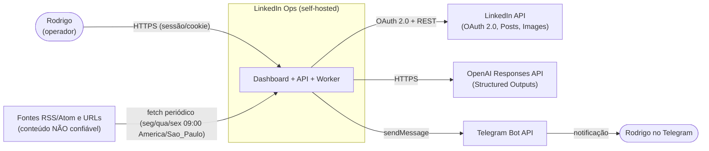
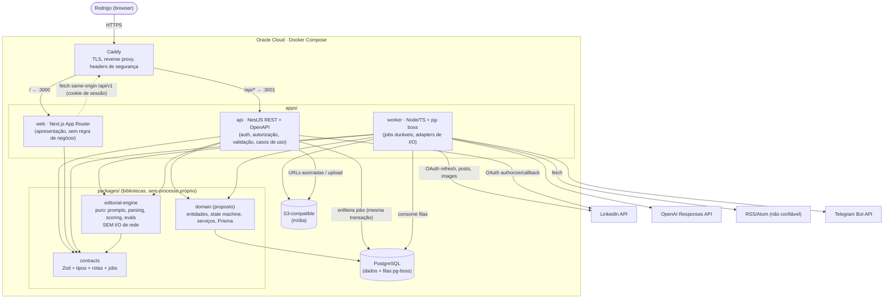

# System overview (C4 níveis 1–2)

- Owner: Atlas (Principal Architect)
- Status: rascunho da Onda 1 (2026-10-13), pendente de consolidação pelo Maestro
- Relacionados: `data-model.md`, `contracts.md`, ADRs 0001–0007 em `docs/adr/`

Este documento descreve o sistema **LinkedIn Ops** em dois níveis do modelo C4: contexto (nível 1) e
containers (nível 2). Ele fixa os _boundaries_ entre `web`, `api`, `worker`, `editorial-engine` e os
serviços externos, e as regras que impedem regra de negócio duplicada em frontend ou controllers.

Identificadores, nomes de containers, filas e tabelas estão em inglês (regra do `CONTRIBUTING.md`).

---

## 1. Nível 1 — Contexto

### 1.1 Atores e sistemas externos

| Ator / sistema                                     | Papel                                                                                                                                         | Confiança                                                |
| -------------------------------------------------- | --------------------------------------------------------------------------------------------------------------------------------------------- | -------------------------------------------------------- |
| **Rodrigo** (operador)                             | Único usuário hoje. Configura fontes, escolhe oportunidades, edita, aprova, agenda e publica.                                                 | Autenticado (sessão)                                     |
| **LinkedIn API** (OAuth 2.0 + Posts/Images API)    | Único canal de publicação. Nunca browser automation, scraping ou engajamento inautêntico.                                                     | Externo confiável, dados de resposta validados           |
| **OpenAI Responses API**                           | Curadoria, geração e avaliação editorial, sempre com Structured Outputs.                                                                      | Externo confiável; saída é **dado**, validado por schema |
| **Fontes de conteúdo** (RSS/Atom, URLs permitidas) | Matéria-prima da curadoria.                                                                                                                   | **Não confiável**: nunca instrução, sempre dado          |
| **Telegram Bot API**                               | Notificação outbound (resumo da curadoria, pedido de revisão, publicado, falha). Não é fonte de verdade nem interface principal de aprovação. | Externo; webhook inbound opcional e verificado           |
| **Armazenamento S3-compatible**                    | Mídia enviada ou renderizada localmente (cards de código).                                                                                    | Infra própria (RustFS em dev/CI / OCI Object Storage)   |
| **Oracle Cloud**                                   | Hospedagem (Docker Compose + Caddy).                                                                                                          | Infra própria                                            |

### 1.2 Diagrama de contexto



### 1.3 Fluxo principal (resumo)

1. Seg/qua/sex 09:00 `America/Sao_Paulo` o worker inicia um `CurationRun`: coleta fontes, normaliza,
   deduplica, classifica e seleciona **exatamente cinco** `Opportunity` (não gera posts).
2. O dashboard mostra os cinco cards. Rodrigo seleciona **uma**.
3. Só então o worker gera o `Draft` (versão 1): post completo, hooks alternativos, fontes usadas, sugestão de mídia.
4. Rodrigo edita (nova versão), regenera (nova versão), aprova, agenda (timezone explícito), publica ou descarta.
5. A publicação é idempotente via LinkedIn API oficial. O resultado é persistido e notificado.
6. Os modos de autonomia (assistido · piloto automático controlado · piloto automático completo) decidem
   quais transições o sistema pode fazer sozinho; o padrão é **assistido**.

---

## 2. Nível 2 — Containers

### 2.1 Diagrama de containers



### 2.2 Responsabilidades por container

| Container             | Tecnologia                                                                    | Responsabilidade                                                                                                                                                                                                                                                                                                                                | O que **não** faz                                                                                                               |
| --------------------- | ----------------------------------------------------------------------------- | ----------------------------------------------------------------------------------------------------------------------------------------------------------------------------------------------------------------------------------------------------------------------------------------------------------------------------------------------- | ------------------------------------------------------------------------------------------------------------------------------- |
| **Caddy**             | Caddy 2                                                                       | TLS automático, roteamento `/` → web e `/api/*` → api, headers (`HSTS`, `X-Content-Type-Options`, `Referrer-Policy`, CSP base), rate limit básico, compressão.                                                                                                                                                                                  | Não autentica nem aplica regra de negócio.                                                                                      |
| **web**               | Next.js App Router, React, TS, Tailwind, shadcn/ui, TanStack Query, RHF + Zod | Dashboard, curadoria (5 cards), estúdio de rascunho, Story Bank, Voice Profile, fontes, calendário, histórico, settings, notificações in-app. Valida formulários com os **mesmos schemas Zod** de `contracts` (UX apenas).                                                                                                                      | Não decide transições de estado, não calcula score, não monta prompts, não guarda segredos, não chama OpenAI/LinkedIn/Telegram. |
| **api**               | NestJS, REST, OpenAPI                                                         | Autenticação (sessão), autorização, validação de entrada (Zod), orquestração de casos de uso, persistência, auditoria, enfileiramento de jobs, OAuth do LinkedIn (authorize/callback), upload de mídia.                                                                                                                                         | Não executa trabalho longo (IA, fetch, publicação) no request. Controllers não contêm regra de negócio.                         |
| **worker**            | Node/TS + pg-boss (NestJS application context, sem HTTP)                      | Consome filas: `source.fetch`, `curation.run`, `draft.generate`, `draft.regenerate`, `media.render`, `media.upload-linkedin`, `publication.publish`, `notification.send`, `linkedin.token-refresh`, `schedule.reconcile`. Implementa os **adapters** de I/O (OpenAI, LinkedIn, Telegram, RSS, S3) e reporta resultados via serviços de domínio. | Não expõe HTTP (só `/health` interno opcional). Não decide sozinho fora do que a `AutonomyPolicy` do domínio permite.           |
| **editorial-engine**  | TS puro (`packages/editorial-engine`)                                         | Registro versionado de prompts e schemas de Structured Outputs, montagem de requests (`build*Request`), parsing/validação de respostas (`parse*Response`), dedupe/ranking heurístico, rubricas e evals, humanização, detecção de clichês. Adapta conceitos do upstream `linkedin-skills`.                                                       | **Nenhum I/O**: sem `fetch`, sem `process.env`, sem banco, sem relógio implícito (clock injetado). Ver ADR-0005.                |
| **contracts**         | TS + Zod (`packages/contracts`)                                               | Schemas e tipos compartilhados: DTOs REST, enums (status, modos), payloads de jobs, erros. Fonte da OpenAPI. Ver `contracts.md`.                                                                                                                                                                                                                | Não contém lógica além de validação estrutural.                                                                                 |
| **domain (proposto)** | TS + Prisma (`packages/domain`)                                               | Entidades, state machine, invariantes, `AutonomyPolicy`, serviços de aplicação, repositórios, auditoria, cifragem de tokens. Compartilhado por `api` e `worker`.                                                                                                                                                                                | Não conhece HTTP nem filas (recebe portas/interfaces). **Pergunta aberta Q1** abaixo.                                           |
| **PostgreSQL**        | 16+, Prisma                                                                   | Dados transacionais, filas pg-boss (schema `pgboss`), audit log append-only.                                                                                                                                                                                                                                                                    | —                                                                                                                               |
| **S3-compatible**     | RustFS (dev/CI) / OCI Object Storage (prod)                                   | Mídia original e renderizada. Objetos privados; acesso via URL assinada emitida pela api.                                                                                                                                                                                                                                                       | Não armazena tokens nem exports privados sem cifra.                                                                             |

### 2.3 Camadas internas da `api` (e do `worker`)

```text
HTTP (controllers, guards, pipes Zod)      ← apps/api            fino, sem regra de negócio
Job handlers (pg-boss)                     ← apps/worker         fino, sem regra de negócio
────────────────────────────────────────────────────────────────────────────────────────
Application services (casos de uso)        ← packages/domain     orquestram, abrem transação, emitem AuditEvent
Domain (entidades, state machine, policies)← packages/domain     regras puras, sem I/O
Ports (interfaces): LlmGateway, LinkedInGateway, TelegramGateway, FeedFetcher, ObjectStorage, Clock, JobQueue
────────────────────────────────────────────────────────────────────────────────────────
Adapters: Prisma repos (domain) · OpenAI/LinkedIn/Telegram/RSS/S3 (worker) · pg-boss (api+worker)
```

Regras:

1. **Regra de negócio só no domínio.** Transições de estado, cálculo de score, elegibilidade para
   auto-aprovação, idempotência e invariantes vivem em `packages/domain` (state machine) e em
   `packages/editorial-engine` (regras editoriais). Controllers, handlers de job e componentes React
   **chamam**; não decidem.
2. **O frontend valida só para UX.** A validação autoritativa é a da api (mesmo schema Zod de `contracts`).
3. **Toda transição passa por `ContentStateMachine.transition(entity, event, actor, policy)`**, que
   valida, aplica, grava `AuditEvent` e retorna os jobs a enfileirar. Não existe `UPDATE status = ...` fora dela.
4. **Prompts nunca em controllers nem em handlers.** Ficam em `packages/editorial-engine/src/prompts/<name>/vN.ts`
   (ver §4).

---

## 3. Como os containers conversam

### 3.1 web → api: sessão, cookie e CSRF

- **Mesma origem via Caddy.** O browser fala com `https://<host>/api/v1/...`; não há CORS em produção.
  Em dev, Next.js faz `rewrites` de `/api/*` para `http://localhost:3001` para manter same-origin.
- **Sessão server-side** (tabela `Session`), id opaco de 256 bits em cookie `__Host-session`:
  `HttpOnly; Secure; SameSite=Lax; Path=/`. Expiração absoluta (ex.: 30 dias) e deslizante (ex.: 7 dias
  sem uso). Logout apaga a linha. Ver ADR-0007.
- **CSRF (defesa em profundidade):** (a) `SameSite=Lax`; (b) a api rejeita toda requisição mutável
  (`POST/PUT/PATCH/DELETE`) cujo `Origin` (ou `Sec-Fetch-Site`) não seja `same-origin`/`APP_BASE_URL`;
  (c) requisições mutáveis exigem `Content-Type: application/json` **e** header `X-Requested-With: linkedin-ops`
  (impede envio por formulário HTML simples); (d) endpoints de **alto risco** (mudar modo de autonomia,
  conectar/desconectar LinkedIn, publicar agora, trocar senha) exigem ainda `X-CSRF-Token` ligado à sessão
  **e sessão elevada** (`POST /auth/reauth` com senha nos últimos 15 min). Callbacks OAuth (`GET`) não mutam
  estado sem `state` válido de uso único. Matriz revisada com Sentinela em 2026-10-13 (ADR-0007, TM-02/TM-22).
- **Server Components** podem ler dados da api repassando o cookie (`fetch` com `headers()`); toda
  **mutação** sai do cliente via TanStack Query → api. Não há Server Actions que toquem o banco: o
  processo `web` **não tem** `DATABASE_URL`, segredos de OpenAI, LinkedIn ou Telegram.
- Respostas de erro seguem Problem Details (`contracts.md` §4); o web mostra, não interpreta regra.

### 3.2 api → jobs: enfileiramento atômico

- pg-boss usa o **mesmo PostgreSQL** (schema `pgboss`). O enfileiramento acontece **na mesma transação**
  que a mudança de estado, usando o executor de banco plugável do pg-boss apontado para a transação
  Prisma (`tx.$executeRaw`). Se isso se mostrar frágil, o fallback é a tabela `outbox_jobs` varrida pelo
  worker (ADR-0002 registra o critério de troca).
- Cada job tem **payload validado por Zod** (`contracts/jobs`), `singletonKey` quando a duplicidade é
  perigosa (ex.: `publication.publish` → `publicationId`), `retryLimit`, `retryBackoff`, `expireIn` e
  dead-letter (`<queue>.dead`) com alerta.
- O cron da curadoria é registrado pelo worker com `pg-boss.schedule('curation.run', '0 9 * * 1,3,5', {}, { tz: 'America/Sao_Paulo' })`
  e cria um `CurationRun` **idempotente por `scheduledFor`** (unique) antes de trabalhar.
- Agendamentos de publicação usam `startAfter = scheduledAt (UTC)` + `singletonKey = publicationId`,
  mais um `schedule.reconcile` a cada 5 min que reenfileira o que estiver vencido e sem job ativo.

### 3.3 worker → resultados

- O worker **não** chama a api por HTTP. Ele importa os mesmos serviços de domínio (`packages/domain`),
  abre a transação, aplica a transição (`GENERATING → DRAFT`, `PUBLISHING → PUBLISHED|FAILED`, …), grava
  `AuditEvent` com `correlationId` do job e enfileira jobs derivados (`notification.send`).
- Resultados de IA passam **obrigatoriamente** por `editorial-engine.parse*Response` (Zod) antes de
  persistir; falha de schema = job falha com erro classificado (`LLM_SCHEMA_MISMATCH`), nunca persistência parcial.
- Falhas definitivas viram estado (`FAILED` com `failureReason` estruturado) + `Notification`, nunca só log.
- O worker registra `jobId`, `attempt`, `queue`, `correlationId` e duração em Pino/OTel; conteúdo de
  prompts e tokens são **redigidos** dos logs.

### 3.4 Integrações externas (adapters no worker)

| Integração | Adapter (porta)   | Regras                                                                                                                                                                                                                                                                             |
| ---------- | ----------------- | ---------------------------------------------------------------------------------------------------------------------------------------------------------------------------------------------------------------------------------------------------------------------------------- |
| OpenAI     | `LlmGateway`      | Só Responses API com `text.format = json_schema` (strict). Modelo e `promptVersion` gravados no `DraftVersion`/`CurationRun`. Conteúdo externo entra como **dado delimitado** no `input`, nunca em `instructions`. Timeout, retry com backoff só em erros transientes.             |
| LinkedIn   | `LinkedInGateway` | Apenas endpoints oficiais versionados (`LinkedIn-Version`, `X-Restli-Protocol-Version: 2.0.0`). Authorize/callback na api; refresh e publicação no worker. Token nunca sai do domínio cifrado (ADR-0004). Idempotência própria (ADR-0003). Sem polling agressivo; respeitar `429`. |
| Telegram   | `TelegramGateway` | Outbound `sendMessage` com `dedupeKey`. Inbound (webhook) **fora do MVP**; se entrar, exige `X-Telegram-Bot-Api-Secret-Token` e só comandos de leitura/ack (nunca aprovação final).                                                                                                |
| RSS/Atom   | `FeedFetcher`     | Allowlist de domínios, limite de tamanho, timeout, `ETag`/`Last-Modified`, sanitização de HTML → texto, sem seguir redirects para IP privado (SSRF). Tudo que vem é `SourceItem` não confiável.                                                                                    |
| S3         | `ObjectStorage`   | Objetos privados, chave `media/<userId>/<assetId>.<ext>`, URL assinada curta para o browser, `sha256` gravado.                                                                                                                                                                     |

---

## 4. Onde ficam os prompts

```text
packages/editorial-engine/
  src/prompts/
    curation/        v1.ts  v2.ts  …     ← seleção das 5 oportunidades
    draft-writer/    v1.ts  …            ← post + hooks + fontes + mídia sugerida
    humanizer/       v1.ts  …
    comment-drafter/ v1.ts  …            ← EPIC-08
    index.ts                              ← registry: { id, version, build(input), outputSchema }
  src/map/                                ← parse*Response: converte a saída do modelo para os DTOs de contracts (ADR-0005 §9)
  (schemas Zod dos Structured Outputs ficam em packages/contracts/src/engine/, conteúdo de Pena, forma de Alicerce; engine → contracts)
  src/evals/                              ← casos bons/ruins/adversariais (prompt injection)
```

- Cada prompt é um **módulo versionado** (`promptId@version`), imutável depois de publicado; mudança = nova versão.
- O prompt nunca contém segredos, nunca contém o conteúdo externo cru sem delimitação, e declara
  explicitamente que o conteúdo entre delimitadores é dado.
- `DraftVersion` e `CurationRun` gravam `promptId`, `promptVersion`, `model` e `engineVersion` para
  reprodutibilidade e para os evals de regressão (Pena mantém o conteúdo; Atlas mantém o boundary).

---

## 5. Observabilidade, saúde e operação

- `GET /api/v1/health` (liveness) e `GET /api/v1/ready` (DB + pg-boss) sem auth; worker expõe `/health`
  em porta interna.
- **Startup fail-closed** (api e worker): fora de `development`, o processo recusa iniciar se
  `SESSION_SECRET`/`ENCRYPTION_KEY` estiverem vazios, com placeholder (`change-me*`), fora do formato
  (base64 de exatamente 32 bytes) ou fracos; o mesmo vale para `DATABASE_URL` com senha de exemplo
  (finding SEC-004 de Sentinela; ADR-0004/0007).
- Logs Pino JSON com `requestId`/`correlationId`, redaction configurada para `authorization`,
  `cookie`, `*.accessToken`, `*.refreshToken`, `*.apiKey`, payloads de prompt.
- OTel traces: HTTP → serviço → job → integração externa, com o mesmo `correlationId`.
- Alertas mínimos: job em dead-letter, token LinkedIn a expirar em < 7 dias, curadoria não executada
  até 09:30, publicação em `PUBLISHING` há > 10 min (ambígua), falha de backup.

---

## 6. Decisões e perguntas abertas (precisam de Rodrigo/Maestro)

| #      | Tema                                                            | Hipótese adotada neste documento                                                                                                                                | Decisão necessária                                                                                                                                                                                                                                     |
| ------ | --------------------------------------------------------------- | --------------------------------------------------------------------------------------------------------------------------------------------------------------- | ------------------------------------------------------------------------------------------------------------------------------------------------------------------------------------------------------------------------------------------------------ |
| **Q1** | Onde vive a regra de domínio compartilhada por `api` e `worker` | Novo pacote `packages/domain` (entidades, state machine, Prisma). Altera a estrutura baseline → registrado como _proposed_ em ADR-0001 §"Structure amendment".  | Aprovar `packages/domain` **ou** escolher alternativa: worker importa módulos de `apps/api` (acoplamento entre apps) ou worker chama api por HTTP interno (mais superfície de auth e dependência de disponibilidade). Recomendação: `packages/domain`. |
| **Q2** | Login                                                           | Credenciais locais (e-mail + senha Argon2id) + sessão server-side. Login via LinkedIn **não** é usado para autenticar (só para conectar a conta de publicação). | **Decidido por Rodrigo em 2026-10-21: login local.** "Sign in with LinkedIn" não autentica; pode virar atalho opcional sobre a conexão OAuth de publicação (T-038).                                                                                    |
| **Q3** | Telegram inbound                                                | Fora do MVP (só notificação).                                                                                                                                   | Confirmar se comandos de leitura/ack (ex.: "ver rascunho") entram em fase posterior.                                                                                                                                                                   |
| **Q4** | Enfileiramento transacional                                     | pg-boss com executor plugado na transação Prisma; fallback outbox.                                                                                              | Nenhuma, só ciência; Alicerce e Pêndulo validam na implementação.                                                                                                                                                                                      |
| **Q5** | Multiusuário futuro                                             | Escopo por `userId` em todas as raízes; autorização centralizada em `AuthorizationService`. Sem `Workspace` agora.                                              | Confirmar que não há necessidade de "equipe" (vários editores do mesmo perfil) no horizonte de 12 meses; se houver, introduzir `Workspace` já na v1 do schema.                                                                                         |
